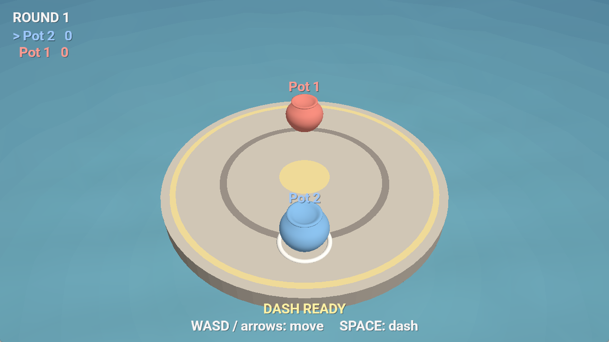

# Pot Sumo

Author: Shangming Zhang

Design: Clay pots shove each other around a stone platform that keeps shrinking; the last pot standing wins the round. A dash makes your pot heavy for a moment, so timing it well wins the shoving match.

Networking: The server (`server.cpp`, `Game.cpp`) is authoritative and runs all physics at 30 ticks/second. Clients only send which buttons are held (`C2S_Controls`, 5 bytes per message), and the server replies every tick with the whole game state (`S2C_State`: round phase, platform radius, and each pot's position, velocity, score, etc.). Both messages are in `Game.hpp` / `Game.cpp`. Up to 8 players; extra connections are refused.

Screen Shot:



How To Play:

Build with `build.bat` (Windows) or `node Maekfile.js`, then run from `dist/`:

```
./server 1337                  (once, on the host)
./client <host> 1337           (once per player; use "localhost" on the same machine)
```

For other machines on the same network, use the host's LAN IP as `<host>` and allow the server through the firewall. Over the internet, forward TCP port 1337 to the host (or use ZeroTier / Tailscale).

- **WASD** / **arrow keys**: move.
- **SPACE**: dash.
- Knock the other pots off the edge; a new round starts automatically once two players are connected.

Sources:
- Models: made for this project in Blender (`scenes/make-pots.py`, `scenes/pots.blend`).
- Font: [Roboto](https://github.com/googlefonts/roboto-classic), SIL Open Font License 1.1 (`dist/font.ttf`, `dist/OFL-Roboto.txt`).

This game was built with [NEST](NEST.md).
